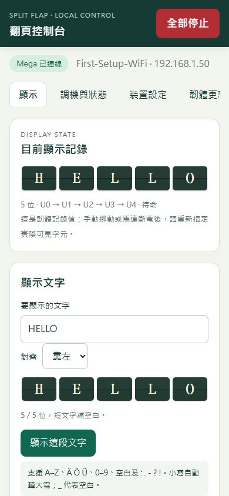

# ESP32-CAM 手機翻頁控制台

AI-Thinker ESP32-CAM 提供繁體中文手機網頁，Mega 2560 負責 1～10 位步進、定位與保護。所有網頁內建在韌體，無外部網站、CDN 或 SD 卡依賴。相機與閃光燈停用。

**需更新兩板韌體。舊 Mega 沒有 Serial1 封包介面，不能直接使用此控制台。** 軟體編譯、主機模擬與瀏覽器測試見 [驗證紀錄](validation.md)；實際接線、兩板 UART、OTA 及多顆機構仍需依文末實機驗收確認。

## 先完成接線

[正常運作完整圖](wiring-runtime.svg) · [CP2102 燒錄完整圖](wiring-flashing.svg) · [逐線表與電源切換](wiring.md)


12V 電源在主開關後分兩路：一路經馬達分支開關供 ULN，另一路經 LM2596 調至 **5.0V** 供控制板。先空載調整、量極性，再接板並量 Wi-Fi 負載下的 5V。馬達支路關閉時，控制板仍有電。

- ESP32-CAM 的 **5V** 腳接降壓器；不是 3V3，也不是標示可能可切換的 VCC。
- Mega 透過 5V USB-A 母座電源小板＋原 USB-A→USB-B 線供電。燒錄 Mega 時，把同一條線的 A 端改插電腦；不要把兩個 5V 電源並接，也不接 Mega 的外部 5V／VIN／DC 圓孔。
- 兩板 UART 經 **TXU0202** 轉換並共地。ESP32 TX=GPIO13、RX=GPIO14；Mega RX1=D19、TX1=D18。轉換板兩側電源來自對應板的 3V3、5V，具斷電高阻保護。
- CP2102 只接 TXD→U0R、RXD←U0T、GND，**5V／3V3／VCC 不接**。需為 3.3V UART 邏輯；部分轉接板的供電跳帽不會改變訊號電壓，依實板量測。

## VS Code：第一次安裝與燒錄

在 repo 根目錄開啟 VS Code；既有 Mega 的 F5 選項保留。

1. F5 選 **ESP32-CAM: 準備環境**。下載固定 Arduino-ESP32 3.3.12、支援 OTA 的板型設定及主機測試用 cJSON。Mega 工具尚未安裝時，先依 [Mega VS Code 指南](../mega2560/vscode.md)準備 Arduino CLI／AVR／主機偵錯工具。
2. 先關馬達 12V 分支，Mega USB 改接電腦，F5 選 **MEGA: 建置＋燒錄＋串列除錯**，確認埠是 Mega，更新本版 Mega 韌體。上傳後預設關閉馬達，會載入有效的 EEPROM 配置。
3. CP2102 USB 接電腦。F5 選 **ESP32-CAM: 查詢連接埠**，記下 CP2102 的 COM；它和 Mega 的 COM 不同，不能照抄預設 COM4。
4. ESP32-CAM 仍由 LM2596 供電。**GPIO0 接 GND，按 RESET**，F5 選 **ESP32-CAM: 建置＋燒錄＋串列監看**，輸入 CP2102 的埠。
5. 上傳成功後 **移除 GPIO0→GND 跳線，再按 RESET**。監看視窗選 115200、換行；輸入 `ACCESS` 查看設備 Wi-Fi 與登入資料。`STATUS` 查看兩板連線。CP2102 未接自動重設線，這些手動步驟不可省略。


主要 F5 功能包括準備／檢查環境、建置、燒錄＋監看、串列監看、全部模擬測試、本機網頁模擬器。`主機中斷點: ESP32↔Mega 通訊與網頁命令` 可檢查通訊控制核心；CP2102 提供燒錄與串列紀錄，沒有實板硬體中斷點功能。

等效指令：

```powershell
python esp32cam/tools/dev.py setup
python esp32cam/tools/dev.py build
python esp32cam/tools/dev.py ports
python esp32cam/tools/dev.py upload-monitor --port COM4
```

編譯不開啟 COM 埠。每次燒錄都先重新建置，失敗不會上傳舊檔；監看只在成功上傳後開啟。ESP32 上傳速率 115200，板型為 `esp32:esp32:esp32cam:PartitionScheme=min_spiffs`。

### Windows 找不到 COM

COM 來自 **CP2102 的 USB**；ESP32-CAM 只有外接 5V，不會自行出現 COM。先關閉外部電源、拔掉 CP2102 到 ESP32 的全部跳線，只讓 CP2102 接電腦 USB。裝置管理員若有「CP2102 USB to UART Bridge Controller」黃色驚嘆號／錯誤碼 28，需安裝 [Silicon Labs CP210x VCP 驅動](https://www.silabs.com/software-and-tools/usb-to-uart-bridge-vcp-drivers)。安裝需 Windows 管理員權限；只使用原廠或 Microsoft 官方簽章套件。

成功後重新執行「查詢連接埠」，看到 `COMx ... Serial Port (USB) Unknown` 即可；`Unknown` 是未辨識 Arduino 板型，不是驅動失敗。ESP32 RESET、GPIO0 或是否已燒韌體都不影響 CP2102 本身的 COM 列舉。

重新接線前確認 ESP32 上明確標示的 **5V** 腳與 GND，**不要把 5V 接另一個 VCC 或 3V3 腳**。不同相容板的 VCC 用途可能不同；沒有清楚 5V 標示時先核對正反面照片／原理圖。閃光 LED 的亮度不能當作供電電壓量測。

## 手機第一次連線

1. 手機加入串列 `ACCESS` 顯示的 **SplitFlap-xxxxxx** Wi-Fi，輸入該設備的隨機直連密碼。手機若提醒「沒有網際網路」，選擇保持連線。
2. 用一般瀏覽器開 `http://192.168.4.1/`。瀏覽器登入視窗使用帳號 **admin**，密碼為 `ACCESS` 顯示的 **Admin password**；兩個密碼分開產生。
3. 到「裝置設定 → 網路與登入」填家用 Wi-Fi，保存後手機改連同一個家用網路。**不需要先連接 Mega，也不需要定位／ARM。** 可開 `http://splitflap.local/`，或用串列 `STATUS`／網頁顯示的 STA IP。
4. 設備直連網路會保留，家用 Wi-Fi 斷線時仍可直連。密碼不寫進 repo、狀態 JSON 或匯出檔。

若忘記密碼，在 CP2102 串列輸入 `ACCESS`。`NETWORK RESET` 會先請求停止，重設 Wi-Fi／登入密碼；不清除 Mega 校準。更換網路設定會暫停自動顯示，需要手動重新啟動。

ESP32 韌體 **1.0.1** 修正「Mega 尚未連線時，保存網路設定按鈕被停用」的問題。使用 1.0.0 時，以原本成功的 CP2102／VS Code 流程更新 ESP32，再重新載入手機頁面；Mega 不必更新，既有 Wi-Fi／登入密碼保留。連線中的 Mega 正在運動、保存或監看，以及 ESP32 正在處理工作／OTA 時，仍需等待或停止後再保存網路設定。

## 沒有磁鐵：先測一位，再擴充

1. 「裝置設定 → 安裝配置」選 **1** 位。位數可任選 1～10；自訂模式例如三位填 `0,2,7`，即依序使用 U0、U2、U7。只啟用實際接上的組別，現有線路無法偵測插拔。
2. 在「顯示 → 手動定位」選出每位**實際可見**字元，按「記錄目前字元」。這一步不轉動，並解除該定位操作涉及位置的 ARM。
3. 確認機構可動，開啟馬達支路，按「啟用全部馬達」，輸入目標文字並送出。各位依序轉動，同時最多一顆通電。
4. 文字太長或含未支援字元會拒絕。短文字按對齊方式補空白；清空輸入會把所有位翻到空白。45 片順序為空白、A–Z、Ä Ö Ü、0–9、`: . - ? !`。`_` 當空白，`$ & #` 亦可代表 Ä Ö Ü。
5. 速度／相序等設定、STEP／REV、STOP、配置更改或重開機後，依顯示的定位狀態重新指定實際字元。不能從通訊成功判斷馬達是否真的轉到位。

U0 已由使用者回報多輪通過的參數是 **SPEED=800、ACCEL=800、REVSTEPS=4096、OFFSET=0、DIR=1、ORDER=1234、POLARITY=LOW**。此組可在「調機與狀態」明確套用測試；新位置沿用原預設 5000／400，避免把單顆實測當成十顆保證。修改後按「保存目前 Mega 參數」才會寫入 EEPROM；「套用並保存」的安裝／校準表單則會直接保存整份設定。

Hall／HOME／MEASURE／CYCLE、LED 相序檢查及單顆 STEP／SHOW 都在「調機與狀態」。LED 測試須拔所選馬達；HOME／MEASURE 須先裝磁鐵並確認 Hall 訊號。

## 時鐘／日期

先完成全部定位與 ARM ALL，再選可用格式、台北 UTC+08:00 及對齊方式。能連上網際網路時自動 NTP 校時；直連離線可按「使用手機時間校時」。斷電後沒有外接 RTC，須重新取得網路時間或手機校時。

| 格式 | 最少位數 |
| --- | --- |
| HHMM／MMDD | 4 |
| HH:MM／MM-DD | 5 |
| YYYYMMDD | 8 |
| YYYY-MM-DD | 10 |

時鐘按分鐘更新，日期按內容變動更新；只轉動變更的位置。忙碌時不累積舊時間工作，完成後重新計算最新目標。關閉網頁、手機離開 Wi-Fi 不會中斷；「暫停自動顯示」讓已接受的工作完成，「全部停止」會停止並使位置失效。USB 調機、兩板失聯或定位失效會暫停自動模式，恢復後需手動啟動。

## 保存、備份與網頁更新

- **Mega EEPROM**：有版本／CRC 的雙槽，保存顯示順序和十組校準。逐 byte 寫入，最後寫提交標記；上一份有效設定保留。無有效資料時只啟用 U0。開機不寫入、不 ARM、不 HOME。
- **ESP32 NVS**：保存 Wi-Fi／登入及顯示偏好。永遠不保存「正在運作」、馬達位置或 ARM。一般移動不寫 Flash／EEPROM。
- **匯出／匯入**：JSON 備份安裝、校準與顯示偏好；不含密碼、位置或 ARM。整份資料驗證成功才接受，保存完成後重新定位。先保存 Mega，再保存 ESP32 偏好；兩板都成功才回報完成。若第二步儲存失敗會回報故障，Mega 已保存的設定保留，修復後重新匯入。
- **OTA**：先按「停止並準備更新」，等 Mega 回覆且狀態確認全關，再上傳 `esp32cam/dist/splitflap-esp32cam.sffw`。包含專案識別、協定、映像長度、ESP32 chip ID 與 SHA-256 驗證；失敗／中斷不選取未驗證映像。更新成功後重開機，重新定位與 ARM。

`.sffw` 是完整性封裝，不是數位簽章；只使用本專案建置的檔案。管理介面以裝置密碼與 Digest／CSRF 保護，適用現場直連或可信任區網，不提供公網遠端服務。OTA 更新 ESP32，Mega 仍由 USB 上傳。

## 開發與實機驗收

```powershell
python mega2560/tools/dev.py test
python esp32cam/tools/dev.py test
python esp32cam/tools/dev.py mock-web
# 開 http://127.0.0.1:8765/，模擬器登入 admin / MockPassword123；不接硬體。
```

另有 F5 **ESP32-CAM: 手機網頁流程測試**，在隔離的 Chrome 視窗驗證手機操作、設定備份、斷線／重啟與 OTA 錯檔／重試，不連接硬體、不讀取個人瀏覽器資料。需要 Node.js、已安裝的 Chrome 與 Playwright；一般建置／燒錄不需要這些工具。首次使用可執行：

```powershell
npm --prefix esp32cam/test install
python esp32cam/tools/dev.py test-web
```

測試前先建置產生 `.sffw`。可用 `SF_NODE`、`SF_PLAYWRIGHT_MODULE`、`SF_WEB_CHROME` 指定已安裝工具路徑；結果與失敗截圖放在忽略版本控制的 `esp32cam/test/.build/`。此模擬器登入及 OTA 都是測試替身，不能代替實板 Digest、Wi-Fi、UART 或 Flash 更新驗收。

[協定與介面](protocol.md) · [接線與供電](wiring.md) · [軟體結果／實機驗收表](validation.md)

手機頁面預覽（電腦模擬資料）：



依序驗收：量供電 → 關馬達支路驗 UART／狀態 → U0 手動定位與文字 → 網頁關閉後繼續 → 拔 UART 兩秒停止 → 兩板重開機載入設定且不動 → 逐顆確認其餘位置 → 多位文字／Hall → OTA。軟體停止不能切斷 12V，實體分支開關仍需保留。
