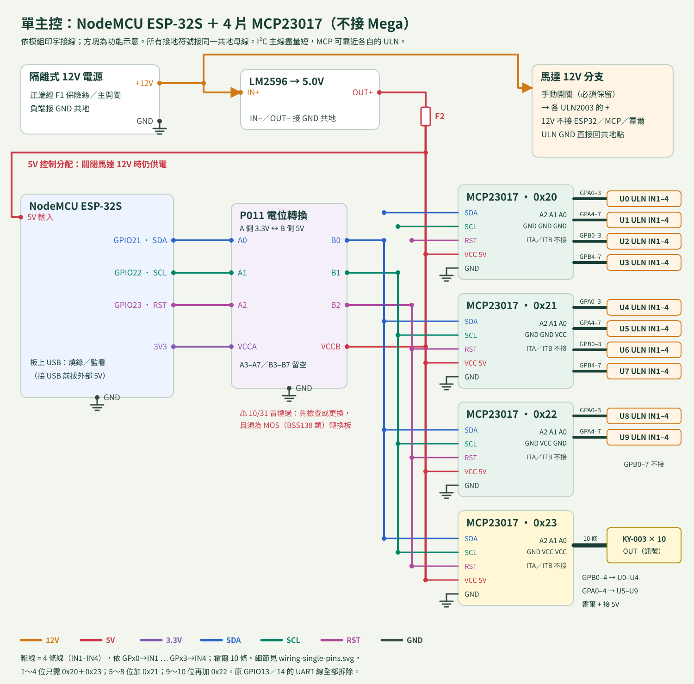
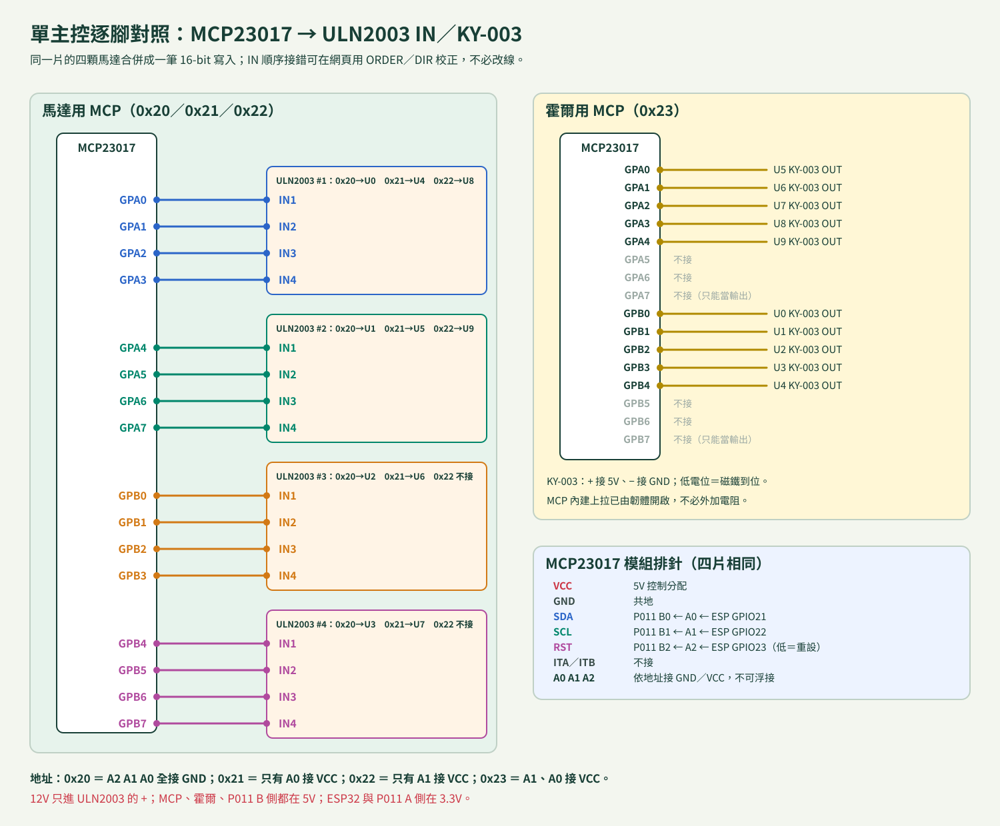

# NodeMCU ESP-32S＋MCP23017 單主控接線表

適用分支 `esp32s-single-controller`、韌體 **2.0.0 單主控**（`python esp32cam/tools/dev.py build --single`）。不接 Mega2560 Pro。手機網頁、Wi-Fi、時鐘、校準、OTA 與雙主控 1.3.x 相同；馬達相位與霍爾改由 ESP32 經 I²C 控制四片 MCP23017。

**尚未實板驗收。**下列為依程式與資料表整理的接線；接電前逐項核對實物印字。雙主控接法見 [wiring.md](wiring.md)，兩套韌體的 OTA 封裝互相拒收。

兩張圖由 `python esp32cam/tools/dev.py diagrams` 產生，也內建在設備網頁（單主控模式的「完整接線圖」）。

## 為什麼走線比較好

- ESP32 只出 **5 條**到 MCP 匯流排：SDA、SCL、RST（經電位轉換）＋5V、GND。
- 每片 MCP 就是一個獨立接線點：0x20～0x22 各接 4 片（0x22 為 2 片）ULN2003 的 IN1～IN4，0x23 接 10 個霍爾。四片可以分組靠近各自的 ULN，用短的 4P 線連接，不必把 50 條線拉回主控。
- I²C 主線（SDA／SCL／RST）盡量短、成束走，總長以幾十公分為目標；較長的線放在 MCP→ULN／霍爾這一段。

## 電源

| 從 | 接到 | 核對事項 |
| --- | --- | --- |
| 12V（F1／總開關後） | 手動馬達開關→各 ULN 的 + | 12V 不接 ESP32、MCP、霍爾或電位轉換板 |
| LM2596 OUT+（調 5.0V）→F2 | NodeMCU 5V 輸入、四片 MCP VCC、霍爾 +、P011 VCCB | 不接任何 3V3 腳 |
| NodeMCU 3V3 | P011 VCCA | 只當 3.3V 參考；不供其他負載 |
| 所有 GND | 共地母線 | 各 ULN GND 直接回電源分配點，不穿過 MCP／ESP32 細線 |

外部 5V 與電腦 USB 互斥：接 USB 燒錄前先拔 NodeMCU 的外部 5V。

## ESP32 → 電位轉換 → MCP（沿用 P011 的三路）

| NodeMCU | P011 低壓側 | P011 高壓側 | 接到 |
| --- | --- | --- | --- |
| GPIO21 | A0 | B0 | 四片 MCP 的 SDA（並聯） |
| GPIO22 | A1 | B1 | 四片 MCP 的 SCL（並聯） |
| GPIO23 | A2 | B2 | 四片 MCP 的 RST（並聯，低電位重設） |
| 3V3 | VCCA | — | |
| — | — | VCCB | 5V 控制分配 |

- P011 曾於 2026-10-31 發生 VCCB 處冒煙；**先確認這片已檢查或更換**，且是 MOS（BSS138 類）雙向轉換，才拿來跑 I²C。A3～A7／B3～B7 留空。
- 原雙主控的 GPIO13／14 UART 線全部拆除，不再使用。
- 開機到韌體接管前，GPIO23 浮接；轉換板的上拉會讓 RST 為高，MCP 以上電預設（全部輸入）啟動，ULN 輸入不被驅動。韌體一開始就把 RST 拉低，初始化完才放開。
- 上拉：每片 MCP 模組與轉換板常各帶上拉，並聯後總值要量；目標 5V 側約 2k～4.7kΩ。400kHz 下的上升時間要用示波器或邏輯分析儀確認。

## MCP23017 地址與腳位

| 地址 | A2 A1 A0 | 腳位 → 接到 |
| --- | --- | --- |
| 0x20 | 0 0 0 | GPA0-3 → U0 IN1-4；GPA4-7 → U1；GPB0-3 → U2；GPB4-7 → U3 |
| 0x21 | 0 0 1 | 同上順序：U4、U5、U6、U7 |
| 0x22 | 0 1 0 | GPA0-3 → U8；GPA4-7 → U9；GPB 不接 |
| 0x23 | 0 1 1 | 霍爾 OUT：GPB0-4 → U0～U4；GPA0-4 → U5～U9；GPA5-7、GPB5-7 不接 |

- 每片的 A0～A2 依表接 GND 或 VCC，不可浮接；地址重複會造成兩片同時回應。
- 霍爾輸入使用 MCP 內建上拉，KY-003 為低電位觸發（極性與雙主控相同）。依現行資料表，GPA7／GPB7 只能當輸出；目前配置每排只用 0～4，不會用到這兩腳。
- MCP 只推 ULN2003 的邏輯輸入，馬達電流由 ULN 承擔。ULN 的 IN1～IN4 順序沿用原本 Mega 的接法；若馬達反轉或抖動，用網頁校準的 ORDER／DIR 調整，不必改線。
- 只裝部分位數時，只需要用到的 MCP：例如 1～4 位只需 0x20＋0x23。缺少必要地址時頁面顯示「MCP 未就緒」，輸出保持關閉；補接後按「全部停止」重新偵測。

## 韌體行為與限制

- 一個高優先序任務每 250µs 喚醒，獨佔 I²C；同一片的四顆馬達合併成一筆 16-bit 寫入。實際步進間隔不會短於設定值（預設 800µs），晚到的 tick 只延後、不補步。
- 每 2ms 讀一次霍爾、每 20ms 輪流稽核一個暫存器。NACK、暫存器被重設或排程停滯超過 100ms，立即拉低 RST、停止全部並解除定位，不會自動重試。
- OTA 寫入前先停止，並在整個寫入期間拉低 RST，所以更新中不會有線圈通電。
- 失去獨立的 Mega 後，ESP32 若當機，RST 不保證保持低。**12V 手動馬達開關必須保留**。
