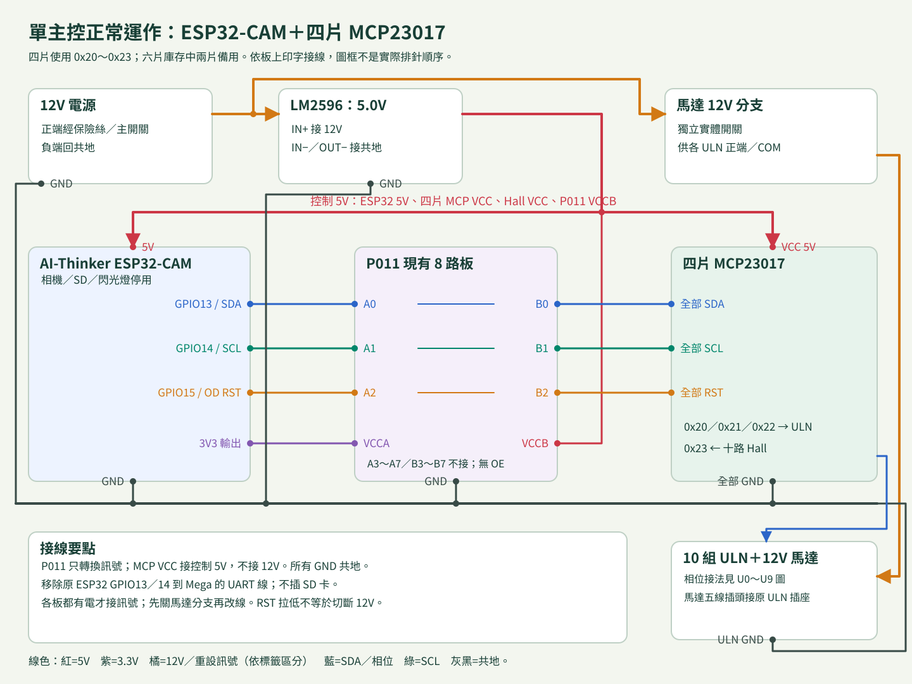
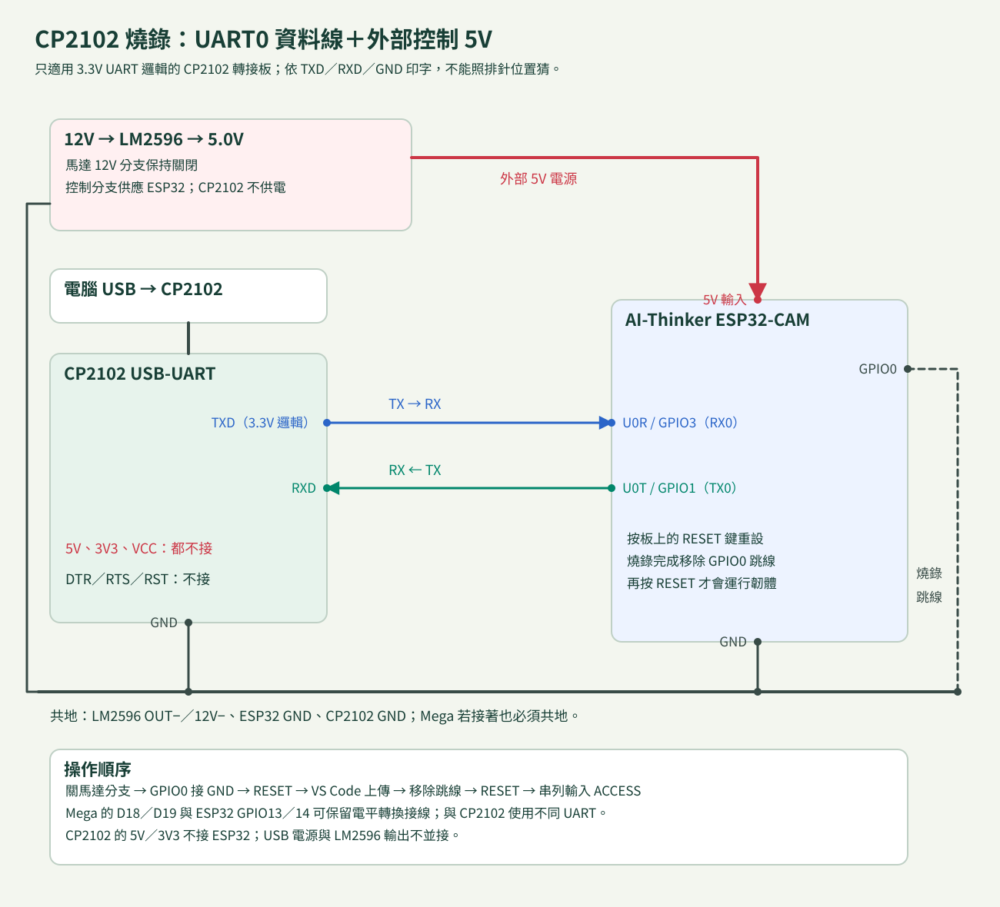

# ESP32-CAM、CP2102、Mega 接線表

圖為功能接線，**依板上印字與量測接線，不依方塊內的上下排列猜排針順序**。目標板為兩側各八針的 AI-Thinker ESP32-CAM；相機與 SD 卡未使用。

## 正常運作

| 從 | 接到 | 說明 |
| --- | --- | --- |
| 12V 正端 | 主保險絲／主開關後分兩支路 | 電源額定、保險絲及線規依實測選定 |
| 控制支路 12V | LM2596 IN+ | 控制支路在馬達分支開關之前 |
| 12V 負端 | LM2596 IN−／OUT−及共地分配點 | 確認模組為非隔離降壓；正負不能接反 |
| LM2596 OUT+（先調 5.0V） | ESP32-CAM **5V** | 不接 3V3 或未確認用途的 VCC |
| LM2596 OUT+／OUT− | USB-A 母座電源小板 5V／GND | 確認 USB VBUS／GND 接腳與極性 |
| USB-A 母座 | 原 USB-A→USB-B 線 → Mega USB-B | 正常運作不用電腦 |
| 馬達分支 12V | 獨立分支開關 → 各 ULN 正端／COM | 不接 Mega、Hall、CP2102、ESP32 GPIO |
| 各 ULN GND | 共地分配點 | 馬達回流不穿過控制板、USB 或 Hall 細線 |
| ESP32 GPIO13 TX2 | TXU0202 A1（5） | 3.3V 發送輸入 |
| TXU0202 B1Y（8） | Mega D19 RX1 | 轉為 5V 的接收訊號 |
| Mega D18 TX1 | TXU0202 B2（1） | 5V 發送輸入 |
| TXU0202 A2Y（4） | ESP32 GPIO14 RX2 | 轉為 3.3V 的接收訊號 |
| ESP32 3V3 | TXU0202 VCCA（3）、OE（6） | 取對應板電源，不能把 VCCA 接 5V |
| Mega 5V | TXU0202 VCCB（7） | 僅供轉換板；不是另一條 Mega 5V 輸入 |
| TXU0202 GND（2） | 共地 | ESP32 GND、Mega GND 均接此共地 |
| 100nF 陶瓷 C1 | VCCA（3）↔ GND（2） | 靠近晶片；模組已有時依原理圖確認 |
| 100nF 陶瓷 C2 | VCCB（7）↔ GND（2） | 同上 |

腳號依 **TXU0202DCU，8-pin VSSOP** 的官方資料表。建議使用已焊接轉接板／模組，包含去耦；不是拿裸 IC 直接接杜邦線。A1→B1Y、B2→A2Y 為固定相反方向，不能當成兩路同向轉換器。任一板未供電時輸出高阻，避免 UART 反向供電。[TI 資料表，Pin Functions／Power Supply](https://www.ti.com/lit/ds/symlink/txu0202.pdf)

LM2596 與 USB 電源小板需能連續承受兩板、Wi-Fi 峰值及 Hall 負載。以具有餘裕的穩壓 5V 供應能力選型，不能把 LM2596 IC 標稱 3A 視為任意小模組的實際連續能力；先量各板 5V 壓降、電流與模組溫升。控制線保持短，遠離馬達主幹。

Mega 原馬達／Hall 腳位與配置見 [Mega 接線表](../mega2560/README.md#十字元腳位與-4p-方向)。GPIO13／14 與 microSD 腳位共用，因此本韌體不初始化 SD 卡。UART0 U0R／U0T 留給燒錄和紀錄；沒有使用 GPIO16／17 這組可能與 PSRAM 衝突的預設 UART 腳位。

## Mega 改接電腦燒錄

1. 關閉馬達分支；LM2596 控制 5V 保持開啟。
2. 將 **同一條 USB-A→USB-B 線的 A 端**從降壓器 USB 母座拔下，改插電腦。Mega 改由電腦 USB 供電。
3. Mega 不再接任何額外 5V 輸入。不使用 USB Y 型電源線，也不把外部 5V 接 Mega 5V 後同時插一般電腦 USB。
4. 完成燒錄後，A 端改回控制 5V 母座；重啟後重新定位、ARM。電平轉換保持兩側對應電源，UART 可保留。

這個接法用插頭位置確保供電互斥，不依賴 Mega 相容板是否具有原版相同的 USB 電源選擇電路。

## CP2102 燒錄 ESP32-CAM

| CP2102／操作 | ESP32-CAM | 說明 |
| --- | --- | --- |
| TXD | U0R／GPIO3 | 3.3V UART 訊號，TX→RX |
| RXD | U0T／GPIO1 | RX←TX |
| GND | GND | 與 LM2596、Mega 共地 |
| 5V／3V3／VCC | **不接** | ESP32 由 LM2596 5V 供電 |
| DTR／RTS／RST | 不接 | 本流程以板上 RESET 鍵手動切換 |
| 燒錄跳線 | GPIO0→GND | 接好後按 RESET，才進入 ROM 燒錄模式 |
| 上傳完成 | 移除 GPIO0→GND，再按 RESET | 開始正式程式；不會自動轉動 |

CP2102 USB 插電腦。確認轉接板 TXD 邏輯為 3.3V；「5V 輸出腳」不代表 TXD 可設為 5V，也不能把 CP2102 的 3V3 腳當 ESP32-CAM 電源。[Silicon Labs CP2102/9 資料表](https://www.silabs.com/documents/public/data-sheets/CP2102-9.pdf)

GPIO0 只在重設時決定啟動模式；上傳後不拔跳線、直接再重設會再次進入燒錄模式。GPIO2 保持原板狀態，不另加跳線。[Espressif Boot Mode Selection](https://docs.espressif.com/projects/esptool/en/latest/esp32/advanced-topics/boot-mode-selection.html)

CP2102 與 Mega 使用兩組獨立 UART，可同時接著；燒錄／重啟前仍先關實體馬達支路。燒錄成功、移除跳線並 RESET 後，115200 串列輸入 `ACCESS` 取得 Wi-Fi 與 admin 密碼。
