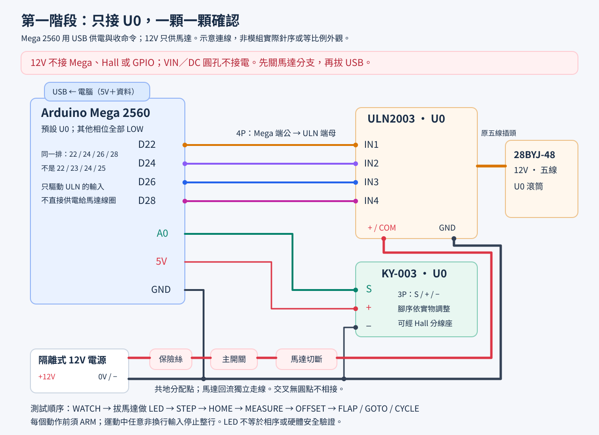
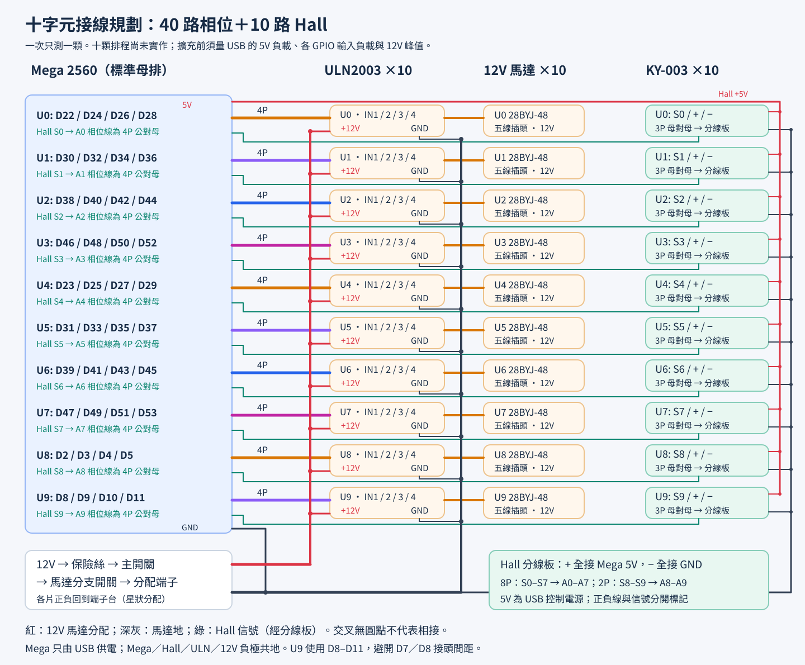
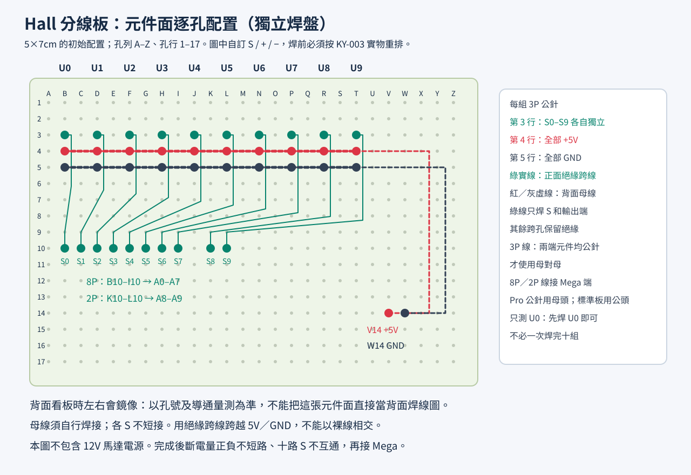

# Mega 2560：先把一個字元接好、轉好

使用已有的 **Mega 2560＋ULN2003＋12V 28BYJ-48＋KY-003**，以電腦 USB 下指令。先只接 U0，一次測一顆；十字元表是佈線規劃，並非十馬達正式韌體。Cardputer／Wi-Fi／RTC 留待後續重構。

磁鐵尚未到貨時，可先用[手動定位與指定字元](#無磁鐵手動定位與指定字元)；這個模式不需要霍爾回饋。

依[分享對話](https://claude.ai/share/2f5c9351-a46a-44d2-a825-716c9a015ebe)最後決策重新實作。快照隱藏互動圖、附件及原 patch，因此本目錄的程式與圖面為新增實作，沒有沿用對話中的編譯數字或聲稱已實物驗證。

## 單顆完整接線



| 從 | 接到 | 說明 |
| --- | --- | --- |
| 電腦 USB | Mega USB | 提供控制 5V 與串列；VIN、DC 圓孔、外部 5V 輸入均不接 |
| Mega D22／D24／D26／D28 | U0 ULN 已確認的 IN1／IN2／IN3／IN4 | 同一排相鄰四針，一條 4P；不是 D22–D25 |
| KY-003 S | Mega A0 | 可經 3P 分線座；程式使用 INPUT_PULLUP |
| KY-003 +／− | Mega 5V／GND | 依實板查針序；不接 12V |
| 隔離式 12V 電源 + | 保險絲 → 主開關 → 馬達分支開關 → ULN 馬達正端／COM | 不接 Mega；保險絲依負載、導線、接點、浪湧選定 |
| 12V 電源 − | 地線分配點 → ULN GND；另一條接 Mega GND | 必須共地；馬達回流不穿過 Mega 或 Hall 細線 |
| 馬達五線插頭 | ULN 馬達插座 | 先確認 12V 型號、共同端、插座映射 |

IN1–IN4 是線束位置名稱，實際相序由板子走線與馬達決定。**斷電查明 ULN E/GND、COM、四路輸出和插座映射後才接電。** ULN 的「+」是馬達正電源，不要因為叫 VCC 就接邏輯 5V。未用輸入保持關閉。參考 [TI 資料表](https://www.ti.com/lit/ds/symlink/uln2003a.pdf)，但模組走線及 LED 的 12V 相容性仍須實測。

標準 Mega 是**母排插座**，ULN 訊號通常是公針，因此馬達線通常買 **4P 公對母**。對話早期的「全部母對母」不適用標準 Mega；改過排針的板子依實物選型。選同一外殼的多 P 線，或確認相鄰單針頭可固定成一束。

重設、上電或 USB 拔除時，GPIO 會回到高阻態。先拔馬達驗證 ULN 不會誤導通；必要時各相在 ULN 端補下拉，10kΩ 是量測起點。GPIO 與 watchdog 都不能取代**實體馬達電源切斷**。關機先關馬達分支，再拔 USB。

## 硬體與多 P 線清單

含機構的 [BOM](../hardware/project-bom.csv) 列有 `bench_quantity`（單顆）與 `required_quantity`（十顆）。對話回報已持有不等於已盤點，先確認缺件再買。

| 品項 | 現在只測單顆 | 十字元規劃／備品 |
| --- | --- | --- |
| Mega 2560、USB 資料線 | 各 1 | 各 1；標準板 USB-B，依實物確認 |
| 12V 馬達、ULN、KY-003、字元機構 | 各 1 | 各 10；翻頁片 45×10 |
| 4P 公對母相位線 | 1 條 | 用 10，建議買 12 |
| 3P 母對母 Hall 線 | 1 條 | 用 10，建議買 12；兩端元件都是公針時 |
| 短 1P 跳線 | S／5V／GND 各 1，另備共地線 | 按佈局；不能作馬達主幹 |
| 8P、2P 公對母 Hall 訊號線 | 不必，U0 可用一條 1P 訊號線 | 各 1；分線板到 Mega |
| 洞洞板、40P 公排針 | 試做分線座，各 1 | 初估 5×7cm 兩片、排針用 2 排備第 3 排；先試排 |
| 12V 電源、保險絲與座、端子台 | 各 1 組 | 電流依實測及啟動峰值選，不直接照抄「3A」保險絲 |
| 直流主開關、馬達分支開關 | 各 1 | 各 1，確認直流負載額定值 |
| 2P 馬達正負電源分支 | 1 組 | 10 組，端子台星狀分配 |
| 電阻、去耦、固定柱、絕緣、線標 | 依實測 | 相位下拉可能 0–40 顆 |
| 2×1mm 磁鐵 | 非鎖存基準 1 顆 | 基準 10 顆；鎖存選項另見[排查](hall-diagnostics.md)，不是直接買 20 顆 |

4P、3P 線先量到最遠 U0／U9 的實際走線距離，加約 10cm 維修餘量。**24AWG「40 芯」不能保證接頭額定值。** 短的單馬達分支可評估 24AWG，須量壓降與溫升；主幹以 18–20AWG 為選型起點，仍須核對長度、電流與端子規格。不要把數條未知品質的杜邦線並聯當主幹。

目前 USB 供一片 Hall 與控制器，不需 P007、LM2596、MCP 或電平轉換板。擴到十片 Hall 前先量總電流與控制 5V 壓降，不能把 USB 保護元件額定值當可用餘量。未來外接 5V 的隔離與切換另行設計，不能把降壓輸出與 USB 5V 並接。

## 十字元腳位與 4P 方向



面向顯示器最左為 U0。下表從 **4P 第1芯到第4芯**排列，對應已確認的 IN1–IN4；半步電氣相序可用 ORDER 調整。

| 字元 | 第1芯 | 第2芯 | 第3芯 | 第4芯 | Hall S |
| --- | --- | --- | --- | --- | --- |
| U0 | D22 | D24 | D26 | D28 | A0 |
| U1 | D30 | D32 | D34 | D36 | A1 |
| U2 | D38 | D40 | D42 | D44 | A2 |
| U3 | D46 | D48 | D50 | D52 | A3 |
| U4 | D23 | D25 | D27 | D29 | A4 |
| U5 | D31 | D33 | D35 | D37 | A5 |
| U6 | D39 | D41 | D43 | D45 | A6 |
| U7 | D47 | D49 | D51 | D53 | A7 |
| U8 | D2 | D3 | D4 | D5 | A8 |
| U9 | D8 | D9 | D10 | D11 | A9 |

D22–D53 是雙排，同排編號跳 2，**不要跨兩排插 4P**。U9 避開 D7／D8 間非 2.54mm 間距，使用 D8–D11。以 [Arduino 官方腳位圖](https://docs.arduino.cc/resources/pinouts/A000067-full-pinout.pdf)對照實物；本目錄示意圖不是等比例外觀。

D0／D1 留給 USB，D18 TX1／D19 RX1 預留未來 UART，D20 SDA／D21 SCL 預留 RTC，目前不使用。沒有 MCP 的 SDA/SCL/RESET 接線；Mega 的 RESET 鍵仍存在。

## Hall 分線洞洞板逐孔配置



圖為 **5×7cm 獨立焊盤板元件面**，A–Z 為自訂孔列、1–17 為孔行。先查實際尺寸及焊盤連通；這是焊接配置，不是麵包板內建導通圖。

1. 十組 3P 公針放在 B／D／F／H／J／L／N／P／R／T 列，第3／4／5行。圖上自訂 S／+／−；**焊前依實際 KY-003 順序重排**，讓整條 3P 線不必散開。
2. 所有「+」在背面以 5V 母線相連，所有「−」以另一條 GND 母線相連，S 不接母線。實物腳序不同，母線位置也要調整。
3. 第10行 B–I 放 8P 座，依序 S0–S7；K–L 放 2P 座，依序 S8–S9。十條 S 各用**絕緣跨線**接自己的輸出孔，跨電源母線處不能露銅。
4. V14／W14 作 +5V／GND 入口，再接到對應母線。電源來自 Mega 5V／GND；十顆擴充前先量 USB 負載。
5. 標記各接頭第1腳與線色，斷電量信號不互通、不短電源，正負不短路。不要依外殼方向推定線序。

只測 U0 可先只焊 U0 的 3P 座，以短線把 S0／+／− 接 A0／5V／GND。麵包板適合這一顆的邏輯試接，12V 馬達電源走額定端子及電線。

## 燒錄與串列操作

**VS Code 使用者：已提供 [F5 建置／燒錄／串列除錯與主機中斷點配置](vscode.md)。Ctrl+Shift+B 可直接建置；F5 選「MEGA: 建置＋燒錄＋串列除錯」。**

Arduino IDE 開啟 `unit_test/unit_test.ino`，選 **Arduino Mega or Mega 2560／ATmega2560**。不需第三方函式庫。燒錄前關馬達 12V，USB 供電；本次不自動對實板燒錄或啟動馬達。

Arduino CLI（repo 根目錄）：

```sh
arduino-cli core install arduino:avr@1.8.8
arduino-cli compile --fqbn arduino:avr:mega:cpu=atmega2560 mega2560/unit_test
# 完成接線檢查後，選正確連接埠燒錄。
```

串列監控選 **115200、Newline 或 CRLF**，每次送一行，等 DONE 再送下一行。批次貼上命令會在運動時觸發停止。開串列埠可能使 Mega 重設，預設不動作、不自動 HOME。

## 依序測試，只接一顆

無磁鐵時，完成斷電檢查、驅動板、空載試轉與方向確認後，先走下方的手動定位流程。Hall／HOME／MEASURE 的關卡待磁鐵到貨後再做。

| 關卡 | 操作 | 通過條件 |
| --- | --- | --- |
| 斷電檢查 | 12V關閉；查極性、相位、共地、短路 | 接線及12V型號確認；手動轉機構不卡滯、不刮線 |
| Hall | `WATCH`，磁鐵靠近、移遠、翻面；`x`加換行退出 | raw與U0=0／1可重複；異常先[排查](hall-diagnostics.md) |
| 驅動板 | **拔馬達**；確認板可承受12V後開分支；`ARM`、`LED` | 四個輸入依序各1秒；實際LED／相位逐一記錄 |
| 空載試轉 | 關12V接馬達、依機構允許固定並卸負載；再開分支；`ARM`、`STEP 100`，再`STEP 500`／`REV` | 平順前進，不只抖動，無異常聲響或溫升 |
| 相序方向 | 關12V查線；必要時`ORDER 1324`或`DIR -1`，再`ARM`試短步 | 符合實際前進翻頁方向；不倒拖已裝翻頁片 |
| 歸零 | `HOME`重做；可從已觸發位置開始 | 先離開磁區再找新邊緣；停點重複；失敗FAULT且斷相位 |
| 圈步數 | `MEASURE` | 三筆`halfsteps=`；初驗最大差以不超過2半步為目標，差大先排漏步／假觸發 |
| 校準圈步數 | `REVSTEPS n`、`ARM`、`HOME` | n是量到的半步／圈；不自動採用量測值 |
| 空白頁 | `OFFSET 0`、`ARM`、`HOME`後短`STEP n`找空白，記累積n；`OFFSET n`、`ARM`、`HOME` | 每次HOME落空白；STEP讓位置失效是正常的 |
| 翻頁 | HOME後`FLAP`、`GOTO 10`、`CYCLE` | 片子完整落下；CYCLE 0–44後跨圈HOME回空白 |
| 停止 | 移動中送`x`加換行或`STOP` | 整行丟棄，停止排程、輸出全低；重新ARM、HOME |

不符合先切斷馬達分支。LED 測試只證明輸入切換，不證明線圈相序、GPIO 電流、ULN 溫升或扭力。只抖動不要提高電壓或加快速度。

## 指令與校準單位

| 指令 | 用途 |
| --- | --- |
| `HELP`／`STATUS` | 指令、U編號、armed、homed、reference、value、index、校準、錯誤 |
| `UNIT 0..9` | 選一顆，全部輸出低、設定恢復預設、解除ARM；預設U0 |
| `WATCH` | 預設LOW有效，raw=LOW時Ux=1；HIGH時Ux=0。斷線也可能HIGH，不能證明連線完整 |
| `ARM`／`OFF`／`STOP` | 允許輸出／全部低且位置無效；無馬達電壓感測，ARM不會驗證電源 |
| `LED` | **拔馬達**；IN1→IN4各1秒，結束全低 |
| `STEP n`／`REV` | 1–20000半步／設定的一圈；不要求HOME，位置會失效 |
| `SET A`／`SET 0`／`SET BLANK` | 宣告目前實際顯示的字元，建立手動位置；不轉動、解除ARM；數字0是第30格 |
| `SETINDEX 0..44` | 依數字索引宣告目前位置；SETINDEX 0為空白頁 |
| `SHOW A`／`SHOW 0`／`SHOW BLANK` | 指定目標字元，需ARM及SET／HOME建立位置；完成後自動更新目前字元 |
| `HOME` | 先離開已有磁區，再找未觸發→觸發的新邊緣、補OFFSET，記第0片 |
| `MEASURE` | 不加OFFSET；找基準邊緣，再量三個完整圈的相鄰觸發邊緣間距；結束位置無效 |
| `FLAP`／`GOTO 0..44`／`CYCLE` | 須SET／HOME及ARM；只前進。手動模式跨圈按步數繞回、CYCLE翻一圈回起始字元；霍爾模式跨圈HOME；每片約停0.5秒 |
| `ORDER 1234` | 半步電氣相序對到四芯；只接受1–4各一次，如1324 |
| `DIR 1`／`DIR -1` | 選電氣方向，讓實際運動符合前進翻頁順序 |
| `REVSTEPS 4096` | 4096只是半步估值；允許1000–20000，以實測為準 |
| `OFFSET 0` | 邊緣到空白頁的半步數，0≤OFFSET<REVSTEPS |
| `SPEED 5000` | 巡航每半步間隔µs；800–30000；越小越快，預設5000 |
| `ACCEL 400` | 加速／減速規劃值，單位半步/s²；100–6000；越小越柔和，預設400 |
| `POLARITY LOW`／`POLARITY HIGH` | 有效電位，不會把鎖存改成非鎖存 |

設定命令解除 ARM、讓位置失效；只存 RAM，切換 UNIT／重開機恢復預設，請抄錄。這是**八狀態半步序列**，不能直接填原 Nano `STEPS=2038` 的全步數；若全步實測為n，先以約2n半步再重測。45片位置以絕對比例取整，避免逐片截斷累積誤差。

索引沿原版：0空白，1–26 A–Z，27 Ä，28 Ö，29 Ü，30–39 數字0–9，40 `:`、41 `.`、42 `-`、43 `?`、44 `!`；使用者已確認實際安裝此45片順序。SET／SHOW以ASCII輸入 `AE`／`OE`／`UE`，也接受相同格位的 `$`／`&`／`#`；空白用 `BLANK` 或 `SPACE`。目前接收單字元或數字索引，尚未提供多字元TEXT。

## 無磁鐵手動定位與指定字元

這個模式以你告訴韌體的目前字元作為位置基準，不會碰到較小的目標就啟動霍爾歸零。原版45片順序必須與實物一致；REVSTEPS必須接近實際每圈半步數。`SET` 只記錄位置，**不會把機構轉到你輸入的字元**。

先確認當前翻頁片已完整落下。以下假設**眼前實際顯示 A**；若目前是別的字元，把 `SET A` 改成實際值。每行分別送出並等回覆，SHOW 要等 DONE：

```text
SPEED 1500
ACCEL 400
SET A
ARM
SHOW 5
```

SET後STATUS應顯示 `reference=MANUAL value=A index=1`，而 `homed=0` 是正常的，表示沒有用霍爾驗證。SHOW完成後應顯示 `value=5 index=35`。接著可分別送 `SHOW B`、`SHOW 0`、`SHOW BLANK`，每次等DONE；韌體會從上次到達的字元繼續計算，不必重新SET。較小的目標按前進方向跨圈；相同字元不會多繞一圈。

| 你想做的測試 | 操作 |
| --- | --- |
| 手動歸零 | 眼前確實是空白頁時，`SET BLANK`；這會記第0格且解除ARM |
| 轉回空白頁 | 有手動位置且ARM後，`SHOW BLANK`；會真的前進到估計的空白頁 |
| 數字0 | `SET 0`／`SHOW 0` 代表數字0（第30格）；`GOTO 0` 是第0格空白，兩者不同 |
| 下一片 | `FLAP`，可跨過 `!` 回空白 |
| 全圈回同字元 | `CYCLE`，從目前字元逐片前進45次後回原字元；不尋找霍爾 |
| 依索引定位 | `SETINDEX n` 宣告目前格位，`ARM`、`GOTO n` 指定目標格位 |

沒有磁鐵時先用SET／SHOW，不執行HOME／MEASURE；這兩個命令仍保留為磁鐵到貨後的霍爾操作。要微調落頁，可ARM後用很短的 `STEP n`，等DONE再對實際看到的字元重新SET、ARM。

SPEED／ACCEL等設定、STOP／OFF、STEP／REV、LED、切換UNIT及重開機都會讓位置失效，STATUS顯示 `reference=NONE value=UNKNOWN`；重新SET當前字元、ARM後才能SHOW。外部馬達斷電或手動挪動機構無法自動被韌體偵測，之後也應重新SET。

4096半步/圈仍是初始估值。先以低速CYCLE確認整圈回到同一頁；若一整圈逐漸偏移，須排除漏步、落頁與相序問題，再調整REVSTEPS並重新SET。手動模式不能量出真實圈步數或偵測高速漏步，DONE只表示預定步數已輸出。

## 加減速與調速

`STEP`、`REV`、`FLAP`、`GOTO` 與 `CYCLE` 的每段定距移動會自動執行「慢速起步 → 加速 → 巡航 → 減速 → 停止」。短距離在到達巡航速度前就開始減速，不會為了跑完加速曲線多走步數。第一步與最後一步間隔至少 **10000µs（100半步/s）**；若 SPEED 設得更慢，則全程維持該慢速。預設仍為 `SPEED 5000`、`ACCEL 400`，重開機不會自動使用高速。

巡航速度以 SPEED 為上限，加減速依 `v² = 起步速度² + 2 × ACCEL × 距離` 規劃，並以剩餘距離限制速度。只在步進時更新整數計算，不使用浮點、等待迴圈或補步暴衝。`ACCEL` 越小，加減速距離越長；短距離能到達的最高速也越低。

**HOME／MEASURE 的磁區搜尋與圈步數量測維持慢速**，每半步間隔為 `max(SPEED, 5000)`；OFFSET 補償也以此為巡航上限並加減速。這些動作必須在磁鐵邊緣定位，遇邊緣時不會為了減速多走幾步。霍爾模式跨圈的 GOTO／CYCLE 先依此慢速歸零，再對定距翻頁加減速；手動模式跨圈直接使用已知步數。舊版若曾以 SPEED 3000 校準歸零，更新後請重新確認 OFFSET 與空白頁停點。

先保持額定12V，在已確認相序與機構允許的方向試轉。以下**每行分別送出，等回覆；STEP 等 DONE**，不要整段一起貼上：

```text
SPEED 1200
ACCEL 800
ARM
STEP 4096
```

先確認SPEED 1500穩定，再試上方1200，之後依序1000、800。每次改設定都要重新ARM，再執行短步／長步測試；STEP／REV會清除手動位置，要測字元定位須再SET當前字元、ARM。若加速中抖動或只嗡叫，先STOP，增加SPEED的數字降低巡航速度，或降低ACCEL讓加減速更柔和，再重試。

**短距離主要受加速度限制。** 例如約91半步的一片翻頁，ACCEL 400時即使SPEED設800，也可能在到達高速前就開始減速；單純降低SPEED不一定更快。可依序試ACCEL 800、1200、2000，並檢查實際頁面；6000是可調上限，尚未實測負載下能否使用。每次改參數後重新SET當前字元、ARM。較小ACCEL會更柔和，也會降低短距離能到達的最高速度。

以4096半步/圈估算，SPEED 1500／1200／1000／800 的**理論巡航**分別約9.8／12.2／14.6／18.3 RPM；起停會增加時間，短距離可能完全達不到巡航速度。800是軟體接受的最快設定，尚未實測這顆馬達帶翻頁機構的可用極限。裝回負載後須逐個核對SHOW／GOTO的實際頁面、重複翻頁及跨圈停點，不能只用BUSY／DONE判定無漏步。

`STOP`／任何非換行輸入、迴圈停滯、逾時及Hall故障都會**立即關閉輸出**，不等待減速；停止後手動模式重新SET當前字元、ARM，霍爾模式重新ARM、HOME。設定與速度只存RAM。STATUS會顯示SPEED與ACCEL，方便記錄每顆的調機值。

動作後保持相位約100ms再釋放。Hall穩定5ms才使用，離開／找邊緣各最多圈步數的1.5倍；每個動作總逾時180秒，太慢或圈步數過大可能先逾時。排程每輪最多一步、不補暴衝；運動中迴圈延遲超100ms會失效停止，AVR watchdog約1秒重設。實際reset／斷電關閉仍依外部電路，須實測。

| U | ORDER | DIR | 半步／圈 | OFFSET | SPEED µs | ACCEL 半步/s² | Hall極性／釋放 | 日期／結果 |
| --- | --- | --- | --- | --- | --- | --- | --- | --- |
| U0 |  |  |  |  |  |  |  |  |
| U1–U9 | 各顆記錄 |  |  |  |  |  |  |  |

軟體與實機邊界見[驗證紀錄](validation.md)。取得單顆量測後再做十顆排程、EEPROM與通訊；保留的[ESP32韌體／模擬](../docs/esp32/README.md)不代表Mega已做同等驗收。
